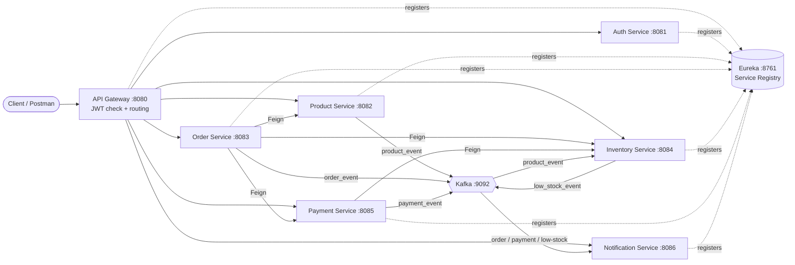
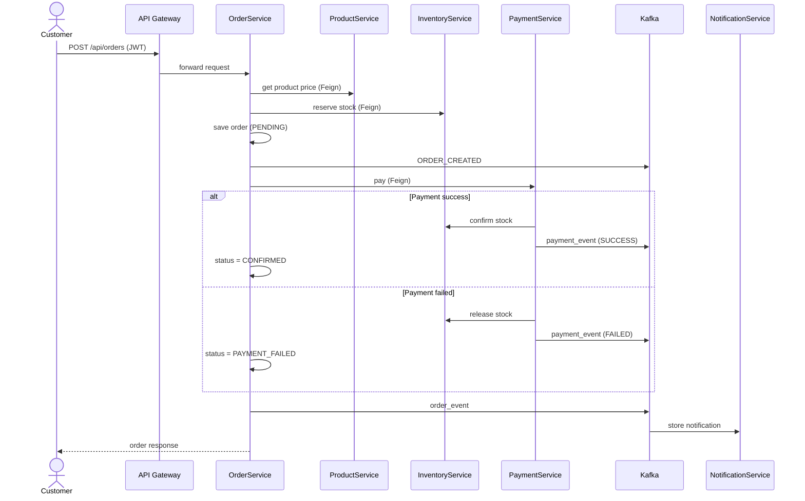

# 🛒 ShopSphere: E-Commerce Microservices Platform

> A production-style, event-driven **e-commerce backend** built with **Java 17, Spring Boot 3.2 and Spring Cloud 2023.0**.
> Eight independent microservices that handle authentication, products, orders, inventory, payments and notifications, all running locally with a single gateway as the entry point.


---

## 📌 Table of Contents

1. [Project Summary (for Recruiters / HR)](#-project-summary-for-recruiters--hr)
2. [Key Features](#-key-features)
3. [Tech Stack](#-tech-stack)
4. [Architecture](#-architecture)
5. [Services Overview](#-services-overview)
6. [Business Flow](#-business-flow)
7. [Prerequisites](#-prerequisites)
8. [How to Download and Run Locally](#-how-to-download-and-run-locally)
9. [Quick Test (5-minute demo)](#-quick-test-5-minute-demo)
10. [API Reference](#-api-reference)
11. [Kafka Events](#-kafka-events)
12. [Security](#-security)
13. [Resilience and Fault Tolerance](#-resilience-and-fault-tolerance)
14. [Testing](#-testing)
15. [Troubleshooting](#-troubleshooting)
16. [Future Improvements](#-future-improvements)


---

## 👔 Project Summary 

This project is a **backend system that simulates how a real online shop works**, similar to the backend of Amazon or Flipkart but in a smaller form.

Instead of building one big application, the system is split into **8 small services**. Each service does one job and has its own database. They talk to each other using **REST calls** and **Kafka messages**.

**What this project demonstrates:**

| Skill | Where it is shown |
|---|---|
| Microservices architecture | 8 independent services, each with its own DB and port |
| Service discovery and API gateway | Eureka + Spring Cloud Gateway |
| Authentication and authorization | JWT login, roles `CUSTOMER` and `ADMIN`, `@PreAuthorize` |
| Event-driven design | Apache Kafka producers and consumers |
| Inter-service communication | OpenFeign clients |
| Fault tolerance | Resilience4J circuit breakers with fallbacks |
| Data consistency | Stock reservation with compensation (rollback) on failure |
| Testing | Unit tests per service + Postman collection with assertions |
| Clean code practices | Layered code, DTOs, role-based access, environment-based config |

**In one sentence:** a customer logs in, places an order, stock is reserved, payment is processed, the order is confirmed or failed, and notifications are generated automatically.

---

## ✨ Key Features

* 🔐 **JWT authentication** with two roles: `CUSTOMER` and `ADMIN`
* 📦 **Product management** (admin creates, updates and deletes products; customers browse)
* 🧾 **Order management** (create order, cancel order, view own orders)
* 🏬 **Inventory management** (reserve, release, confirm, restock, low-stock alerts)
* 💳 **Simulated payment gateway** (success and failure scenarios)
* 🔔 **Notifications** generated from Kafka events (email is simulated by logging)
* 🚪 **Single entry point** through the API Gateway (`localhost:8080`)
* 🛡️ **Circuit breakers** on every Feign client so one service failure does not crash everything
* 🔁 **Compensation logic**: stock reserved for a failed order is released automatically
* 🧪 **Postman collection** that runs the full flow with automated assertions

---

## 🧰 Tech Stack

| Area | Technology |
|---|---|
| Language | Java 17 |
| Framework | Spring Boot 3.2 |
| Microservice toolkit | Spring Cloud 2023.0 (Eureka, Gateway, OpenFeign) |
| Messaging | Apache Kafka 3.x (KRaft mode, no ZooKeeper) |
| Database | MySQL 8 (one database per service) |
| Security | Spring Security, JWT (HS256) |
| Resilience | Resilience4J (Circuit Breaker + Fallback) |
| Build tool | Maven 3.9+ |
| API testing | Postman |

---

## 🏗️ Architecture



**Design rules followed:**

* Every service is a **separate Maven project** (no parent POM, no multi-module) so each can be built and run independently.
* **Database per service**: no service reads another service's tables.
* Synchronous calls use **Feign**, asynchronous events use **Kafka**.
* The **gateway** is the only public entry point; services are reached by name (`lb://SERVICE-NAME`) through Eureka.

---

## 🧩 Services Overview

| Service | Port | Database | Responsibility |
|---|---|---|---|
| **EurekaService** | 8761 | - | Service registry and dashboard |
| **APIGatewayService** | 8080 | - | Single entry point, JWT validation, routing (`lb://`) |
| **AuthService** | 8081 | `auth_db` | Register, login, JWT creation, roles `CUSTOMER` + `ADMIN` |
| **ProductService** | 8082 | `product_db` | Admin CRUD, customer read-only, publishes `product_event` |
| **OrderService** | 8083 | `order_db` | Create and cancel orders, calls Product, Inventory and Payment via Feign, publishes `order_event` |
| **InventoryService** | 8084 | `inventory_db` | Consumes `product_event`; reserve / release / confirm / restock stock; publishes `low_stock_event` |
| **PaymentService** | 8085 | `payment_db` | Payment success / failure, calls Inventory via Feign, publishes `payment_event` |
| **NotificationService** | 8086 | `notification_db` | Consumes order, payment and low-stock events and stores notifications |

---

## 🔄 Business Flow

### Order lifecycle (step by step)

1. **Admin creates a product** (with `initialStock`). ProductService saves it and publishes `PRODUCT_CREATED` on `product_event`.
2. **InventoryService** consumes that event and creates the stock row.
3. **Customer creates an order.** OrderService (via Feign):
   * gets the price from ProductService,
   * **reserves** stock in InventoryService (available → reserved),
   * saves the order and publishes `ORDER_CREATED`,
   * calls PaymentService.
4. **PaymentService** processes the payment:
   * ✅ **Success** → Inventory `confirm` (reserved quantity is permanently deducted)
   * ❌ **Failure** → Inventory `release` (quantity is added back)
   * saves the payment and publishes `payment_event`.
5. **OrderService** sets the order status to `CONFIRMED` or `PAYMENT_FAILED`, then stores and publishes `order_event`.
6. **Cancel** (only allowed for `CONFIRMED` orders) → Inventory `restock`, order becomes `CANCELLED`, and `ORDER_CANCELLED` is published.
7. **Low stock alert**: InventoryService publishes `low_stock_event` when available stock is **5 or fewer**.
8. **NotificationService** consumes order, payment and low-stock events and stores notifications (email is simulated by logging).

### Sequence diagram (place an order)



### Order statuses

| Status | Meaning |
|---|---|
| `CONFIRMED` | Stock reserved and payment succeeded |
| `PAYMENT_FAILED` | Payment was declined, stock was released |
| `CANCELLED` | Customer cancelled a confirmed order, stock was restocked |

---

## ✅ Prerequisites

Install these on your machine **before** running the project:

| Tool | Version | Check command |
|---|---|---|
| JDK | 17 or higher | `java -version` |
| Maven | 3.9+ | `mvn -version` |
| MySQL | 8 | `mysql --version` |
| Apache Kafka | 3.x (example uses 3.7.0) | - |
| Git | any | `git --version` |

**MySQL settings**

* Must run on `localhost:3306`
* Default credentials: user `root`, password `root`
* To use different credentials, set environment variables `DB_USER` and `DB_PASSWORD`
* **You do not need to create databases manually.** They are created automatically.

---

## 🚀 How to Download and Run Locally

### Step 1: Download the project

```bash
git clone <YOUR-REPOSITORY-URL>
cd <YOUR-REPOSITORY-FOLDER>
```

Or click **Code → Download ZIP** on GitHub and extract it.

### Step 2: Start MySQL

Make sure the MySQL server is running on port `3306`.

### Step 3: Start Kafka (KRaft mode, no ZooKeeper)

```bash
cd kafka_2.13-3.7.0
KAFKA_CLUSTER_ID=$(bin/kafka-storage.sh random-uuid)
bin/kafka-storage.sh format -t $KAFKA_CLUSTER_ID -c config/kraft/server.properties
bin/kafka-server-start.sh config/kraft/server.properties
```

> **Windows:** use the scripts in `bin\windows\*.bat` instead.
> Kafka topics are created automatically by the services, so nothing else is needed.

### Step 4: Start the services (one terminal per service)

⚠️ **Order matters.** Start Eureka first and wait until it is fully up.

```bash
cd EurekaService         && mvn spring-boot:run     # 1st, wait until it is up
cd APIGatewayService     && mvn spring-boot:run
cd AuthService           && mvn spring-boot:run
cd ProductService        && mvn spring-boot:run
cd InventoryService      && mvn spring-boot:run
cd PaymentService        && mvn spring-boot:run
cd OrderService          && mvn spring-boot:run
cd NotificationService   && mvn spring-boot:run
```

### Step 5: Verify everything is running

Open the Eureka dashboard: **http://localhost:8761**

You should see all services listed as `UP`.

### Default admin account

| Email | Password |
|---|---|
| `admin@shop.com` | `Admin@123` |

It is created automatically the first time AuthService starts. Customers register themselves using `/api/auth/register`.

---

## ⚡ Quick Test (5-minute demo)

All requests go through the gateway: **`http://localhost:8080`**

### Easiest way: Postman

1. Import `postman/ShopSphere_Microservices_Collection.json`
2. Open **Runner** and run the collection **in order**
3. Tokens and IDs are saved automatically in collection variables
4. The collection includes assertions for role-based access, stock changes, payment failure and cancel flows

### Manual way: curl

**1. Login as admin and get a token**

```bash
curl -X POST http://localhost:8080/api/auth/login \
  -H "Content-Type: application/json" \
  -d '{"email":"admin@shop.com","password":"Admin@123"}'
```

**2. Use the token on protected endpoints**

```bash
curl http://localhost:8080/api/products \
  -H "Authorization: Bearer <YOUR_JWT_TOKEN>"
```

**3. Place an order (as a CUSTOMER)**

```bash
curl -X POST http://localhost:8080/api/orders \
  -H "Authorization: Bearer <CUSTOMER_JWT_TOKEN>" \
  -H "Content-Type: application/json" \
  -d '{
        "items": [ { "productId": 1, "quantity": 2 } ],
        "paymentMethod": "CARD",
        "cardNumber": "4111111111111111"
      }'
```

> For exact request bodies of register and product creation, see the Postman collection.

### Test payment failure

A card number ending in **`0000`** (or payment method **`FAIL`**) is declined by the simulated gateway. The order becomes `PAYMENT_FAILED` and stock is released automatically.

```json
{ "items": [ { "productId": 1, "quantity": 1 } ], "paymentMethod": "CARD", "cardNumber": "4111111111110000" }
```

---

## 📚 API Reference

Base URL: `http://localhost:8080`

### Auth

| Method | Path | Access |
|---|---|---|
| POST | `/api/auth/register` | Public |
| POST | `/api/auth/login` | Public |
| GET | `/api/auth/me` | Any logged-in user |
| POST | `/api/auth/admin/register` | ADMIN |

### Products

| Method | Path | Access |
|---|---|---|
| POST | `/api/products` | ADMIN |
| PUT | `/api/products/{id}` | ADMIN |
| DELETE | `/api/products/{id}` | ADMIN |
| GET | `/api/products`, `/api/products/{id}` | CUSTOMER, ADMIN |

### Orders

| Method | Path | Access |
|---|---|---|
| POST | `/api/orders` | CUSTOMER |
| PUT | `/api/orders/{id}/cancel` | CUSTOMER (owner only) |
| GET | `/api/orders/my` | Role based |
| GET | `/api/orders/{id}` | Role based |
| GET | `/api/orders` | ADMIN |

### Inventory

| Method | Path | Access |
|---|---|---|
| GET | `/api/inventory/{productId}` | Role based |
| GET | `/api/inventory` | ADMIN |
| POST | `/api/inventory/add-stock` | ADMIN |

### Payments

| Method | Path | Access |
|---|---|---|
| GET | `/api/payments/my` | Authenticated |
| GET | `/api/payments/order/{orderId}` | Authenticated |

### Notifications

| Method | Path | Access |
|---|---|---|
| GET | `/api/notifications/my` | CUSTOMER |
| GET | `/api/notifications` | ADMIN |
| GET | `/api/notifications/admin-alerts` | ADMIN |

---

## 📨 Kafka Events

| Topic | Produced by | Consumed by | Examples |
|---|---|---|---|
| `product_event` | ProductService | InventoryService | `PRODUCT_CREATED` |
| `order_event` | OrderService | NotificationService | `ORDER_CREATED`, `ORDER_CANCELLED` |
| `payment_event` | PaymentService | NotificationService | payment success / failure |
| `low_stock_event` | InventoryService | NotificationService | stock ≤ 5 |

---

## 🔐 Security

* The **API Gateway validates the JWT** on every request.
* **Each service validates the JWT again** (shared HS256 secret `jwt.secret`), so services stay safe even if called directly.
* **Role-based access control** is enforced with `@PreAuthorize` (`CUSTOMER` vs `ADMIN`).
* The caller's token is **forwarded explicitly** on Feign calls between services.
* Customers can only cancel or view **their own** orders.

---

## 🛡️ Resilience and Fault Tolerance

* Every Feign client in **OrderService** and **PaymentService** runs inside a **Resilience4J circuit breaker** with a **fallback factory**.
* Business errors (HTTP 4xx) are **passed through** to the caller unchanged.
* Service outages are converted into a clean **HTTP 503** response.
* **Compensation:** if an order fails after stock was reserved, the reserved stock is released automatically so inventory never stays locked.

---

## 🧪 Testing

Run unit tests inside any service folder:

```bash
cd OrderService
mvn test
```

> Tests do **not** need MySQL or Kafka running.

For end-to-end testing use the Postman collection in `postman/`.

---

## 🛠️ Troubleshooting

| Problem | Likely cause | Fix |
|---|---|---|
| `Access denied for user 'root'` | Wrong MySQL password | Set `DB_USER` and `DB_PASSWORD` environment variables |
| Services do not appear in Eureka | Eureka started late | Start Eureka first, wait, then start the others |
| `Connection refused localhost:9092` | Kafka not running | Start Kafka (Step 3) |
| `Port already in use` | Another app uses the port | Stop it or free ports 8080-8086 and 8761 |
| `401 Unauthorized` | Missing or expired token | Login again and send `Authorization: Bearer <token>` |
| `403 Forbidden` | Wrong role | Use an ADMIN token for admin endpoints |
| `503 Service Unavailable` | A dependent service is down | Check the Eureka dashboard and restart the service |
| `java: invalid target release` | Old JDK | Install JDK 17 or higher |

---

## 🔧 Production Notes and Future Improvements

Production hardening is **intentionally not included** to keep the project easy to run locally. Before real deployment:

* Change `jwt.secret` and all database passwords
* Add the **Outbox pattern** and **Kafka transactions** for guaranteed event delivery
* Add Docker and Docker Compose
* Add centralized config, distributed tracing and monitoring

---

